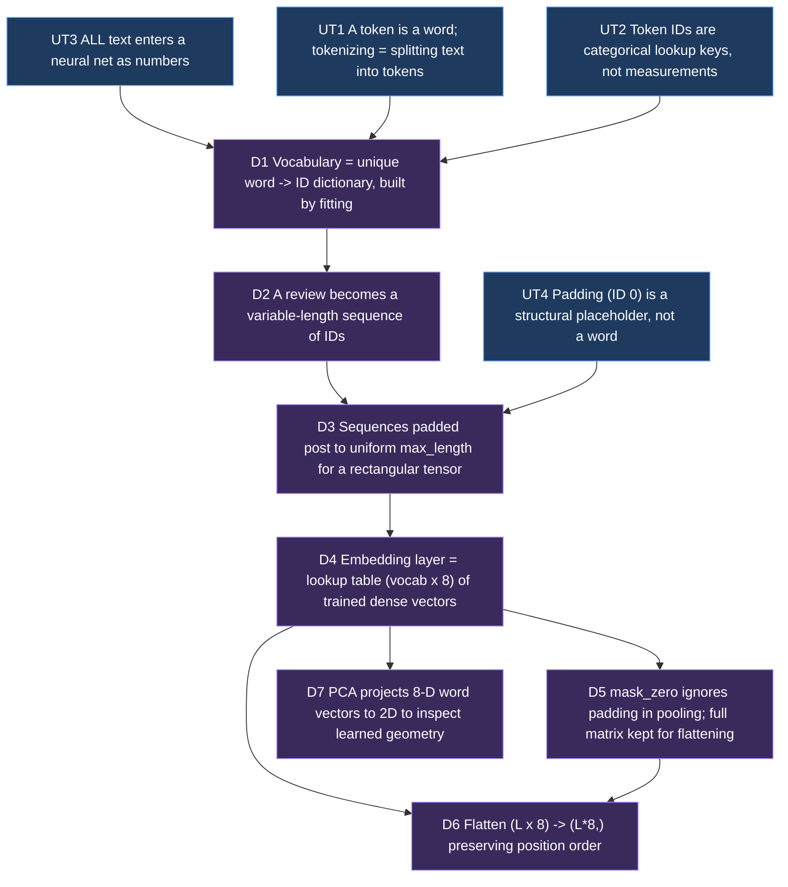

# Lab 3 — Text-to-Latent Representation (explain-the-lab)

Goal (learner): explain what/how/why of the lab; tokenization is the named weak spot.
Prior sessions: lab1 (Q-learning) and lab2 (CNN) already logged; learner prefers
expository delivery and explicitly asks for answers with reasoning when probes get hard.

## Planned knowledge graph

Teaching order follows the arrows: roots UT1-UT4 first, then D1-D7.

## Probe 2026-10-01 (tokenization edge)

> Q1 tokenizer function: 1/2/3/4 -> Learner: X (reasoning: splits sentence into pieces
> by fixed delimiters / predefined set / splitting function)
> Q2 ID meaning: 1/2/3/4 -> Learner: 3
> Q3 padding reason: 1/2/3/4 -> Learner: X (then 2, "all reviews should be the same size
> for standardization")

Correct: Q1=3, Q2=3, Q3=2.

## Session log 2026-10-01

> Taught expository: UT3, UT1, D1, UT2, D2, D3, UT4, D4, D5, D6, D7,
> plus preprocessing rationale and the flattening-vs-pooling distinction.
> Probe answers supplied inline (learner requested exposition in prior sessions).

> Q2 graded: CORRECT (option 3). Node UT2 landed. Confidence not stated; placed at 14 (solid).

> Q3 graded: CORRECT (option 2). Node UT4/D3 landed. Learner reasoning
> "all reviews should be the same size for standardization" is exactly right.
> Confidence 2 (fairly sure). Placed at 7 (recalled, not instant).

> Q1 graded: WRONG (option 1). Real misconception, not a slip. Correct = 2.
> Learner reasoning "it wouldn't make sense to remap everything just because of a few more
> words" is reasonable but wrong: Keras Tokenizer rebuilds the whole dictionary on every
> fit_on_texts, so existing word IDs CAN change when new text is added. Practical impact:
> refitting a tokenizer after training invalidates the embedding weights. Fix = fit once,
> reuse/save the fitted tokenizer. Learner confidence: "i think" -> ~2 (confident-wrong).
> Needs hard correction, not a top-up.

> Q2 graded: X. Learner got the mechanism right ("find the matching IDs using a lookup
> table") but the output wrong ("gives back the ID"). Correct: returns the 8-number
> VECTOR (row of the (vocab_size, 8) matrix), never the integer. vocab_size = unique words
> + 1 (padding row); 8 = embedding dimension, a chosen number. Learner confidence:
> "somewhat sure still had my doubts" -> 2.

> Q3 graded: X. No reasoning given. Correct: pooling = average real (non-padding) word
> vectors -> 8 numbers, discards position; flattening = unroll (L,8) -> L*8 numbers,
> keeps position order. Learner confidence: not stated.

> Q4 graded: CORRECT (option 2). Node D7 landed. Reasoning "PCA finds the greatest
> variance directions, not semantic values" is right. Placed at 7.

## Review queue
- [ ] Q1 refit-remaps-IDs misconception - due 2026-10-02 (confident-wrong, hard correction)
- [ ] Q2 embedding returns vector not ID; (vocab_size, 8) shape - due 2026-10-02
- [ ] Q3 flatten vs pool distinction - due 2026-10-02
- [ ] UT2 IDs are lookup keys not measurements - due 2026-10-02 (was solid at 14)
- [ ] UT4 padding is a masked placeholder, not a word - due 2026-10-02
- [ ] D7 PCA is variance-preserving not semantic - due 2026-10-08 (was 7)

## Learned knowledge graph

_(written when the last unlanded node passes its quiz-check)_